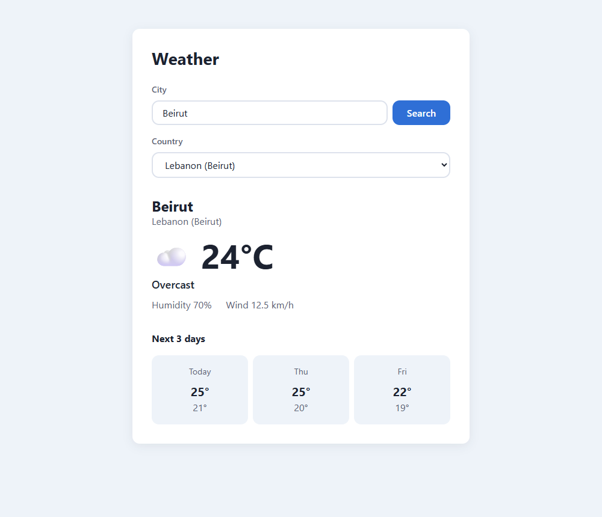
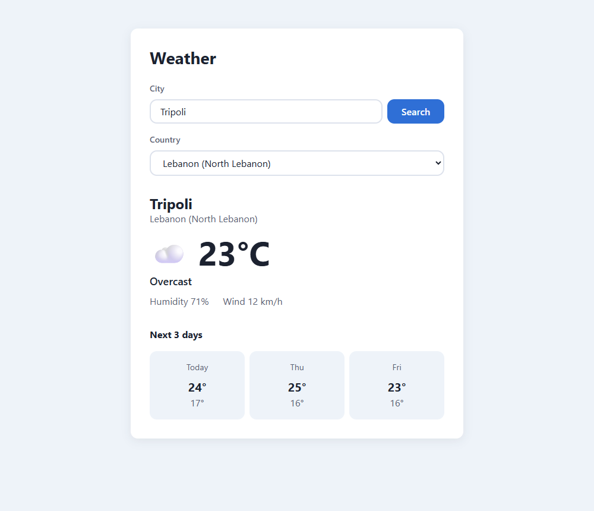
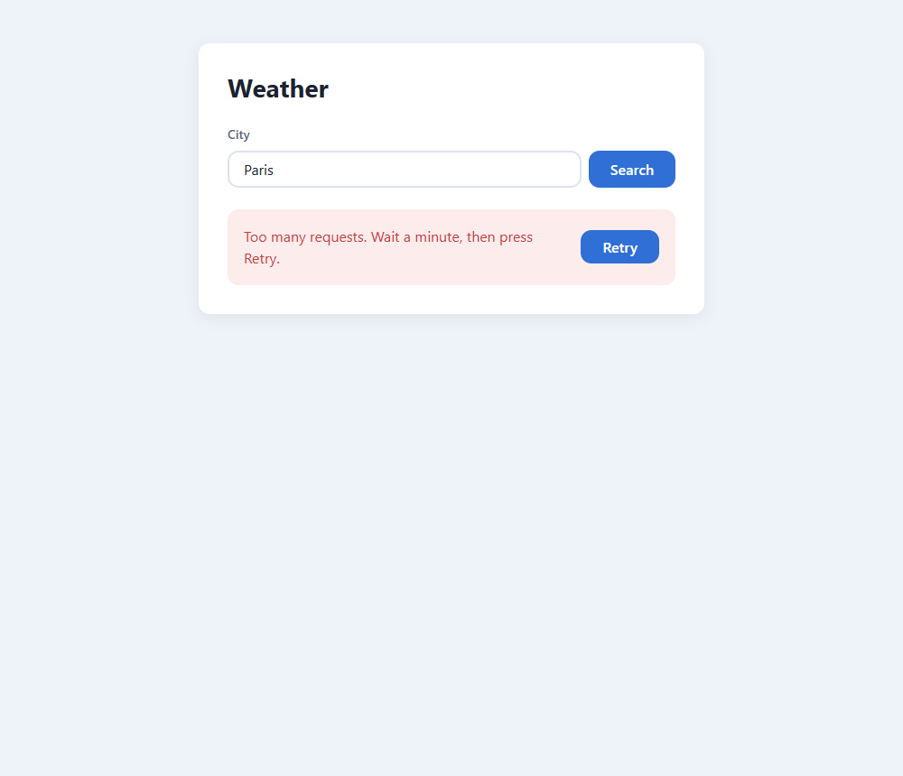
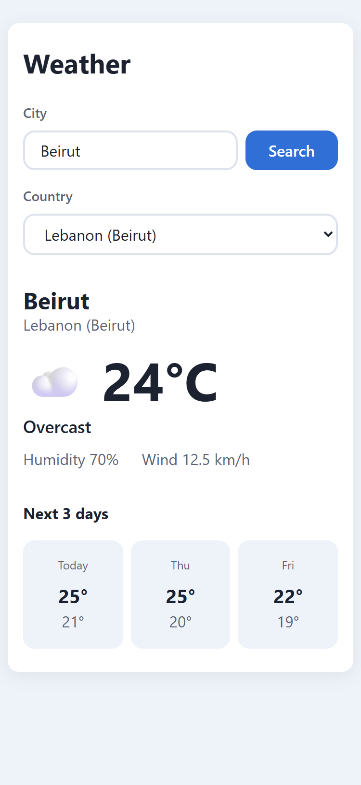

# Weather Dashboard (React)

The Assignment 4 Weather Dashboard rebuilt in React. Type a city name and the app fetches live weather for it from the [Open-Meteo](https://open-meteo.com/) API. No API key is needed.



## Setup

Requires [Node.js](https://nodejs.org/) 20.19+ or 22.12+.

```bash
npm install
npm run dev
```

Then open the address Vite prints, usually <http://localhost:5173/>.

Other scripts:

| Command | What it does |
| --- | --- |
| `npm run build` | Production build into `dist/` |
| `npm run preview` | Serves the production build |
| `npm run lint` | Runs ESLint, including the React Hooks rules |

The project was created with `npm create vite@latest` (React, JavaScript).

## Features

- **Search:** enter a city name and press Search or Enter. An empty search shows "Type a city name first." under the field. The message clears as soon as you type.
- **Country:** when several places share a name, such as Tripoli, pick the right one from the Country list.
- **Current weather:** temperature, conditions, an icon, humidity and wind speed.
- **3-day forecast:** high and low temperatures for each day.
- **Loading state:** shown while a request runs. Search and Country are disabled until it finishes.
- **Error states**, each with its own message:
  - city not found;
  - no internet connection;
  - too many requests (HTTP 429);
  - the weather service returning an error.
- **Retry:** repeats the request that failed and keeps the country you picked.
- **Responsive:** works at phone and desktop widths.

| Several countries | Error with Retry | Phone |
| --- | --- | --- |
|  |  |  |

## Component tree

```
App                     owns the shared state and both effects
├── SearchBar           onSearch, disabled
├── PlacePicker         places, selected, onSelect, disabled
├── StatusBox           idle hint, passed as children
├── LoadingSpinner      message
│   └── StatusBox       tone="loading", children
├── ErrorMessage        message, onRetry (optional)
│   └── StatusBox       tone="error", children
├── WeatherCard         weather
└── Forecast            daily
    └── ForecastDay     label, high, low
```

Data goes down as props and events come back up through callbacks: `onSearch`, `onSelect`, `onRetry`.

`StatusBox` draws the frame shared by the idle, loading and error messages. `LoadingSpinner` and `ErrorMessage` choose what goes inside it through `children`.

## State

| State | Where | Why it lives there |
| --- | --- | --- |
| `text`, `error` | `SearchBar` | Only the form needs each keystroke and the validation message. `App` receives just the submitted city. |
| `city` | `App` | The submitted search. It triggers the place lookup and is used in the "not found" message. |
| `places`, `placeIndex` | `App` | Read by `PlacePicker`, which changes the index. The chosen place triggers the weather request. |
| `weather` | `App` | The loaded data, read by `WeatherCard` and `Forecast`. |
| `status`, `error` | `App` | `status` is `idle`, `loading`, `ready`, `not-found` or `error`. It decides which screen renders. |
| `attempt` | `App` | Counter bumped by Search and Retry so the same city can be fetched again. |

The search results are needed by sibling components (`PlacePicker`, `WeatherCard`, `Forecast` and the status messages), so that state is lifted to their closest common parent, `App`.

Values that can be computed are not stored: `place` (`places[placeIndex]`), `isLoading` and the loading text are calculated on each render.

## Effects

Both effects live in `App.jsx` and follow the pattern from Session 15: an `async` function defined inside the effect, then called.

1. **Find places**, dependencies `[city, attempt]`: looks up the city with the geocoding API and stores the matches in `places`.
2. **Load weather**, dependency `[place]`: runs whenever the chosen place changes, after a new search, a different country or a retry.

Each effect returns a cleanup function that sets `ignore = true`. A response that arrives after the user has moved on is then thrown away instead of replacing newer data.

## Prop drilling

No state is passed down more than two levels. The deepest path is `App` → `Forecast` → `ForecastDay`, and each level uses what it receives: `Forecast` splits `daily` into one day per `ForecastDay`. Because nothing is passed through unused, Context is not needed.

## Files

| File | Purpose |
| --- | --- |
| `src/main.jsx` | Mounts `App` |
| `src/App.jsx` | Shared state, data-fetching effects, which screen to show |
| `src/weather.js` | API requests (`fetch` with async/await), weather codes, place labels |
| `src/index.css` | Design tokens, page layout, shared field and button styles |
| `src/components/*.jsx` | One component per file, each with its own `.css` file when it needs styles |
